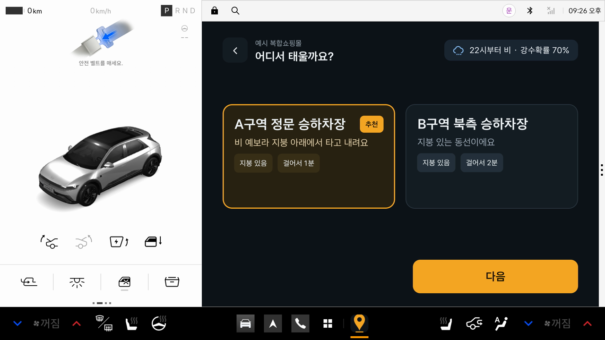
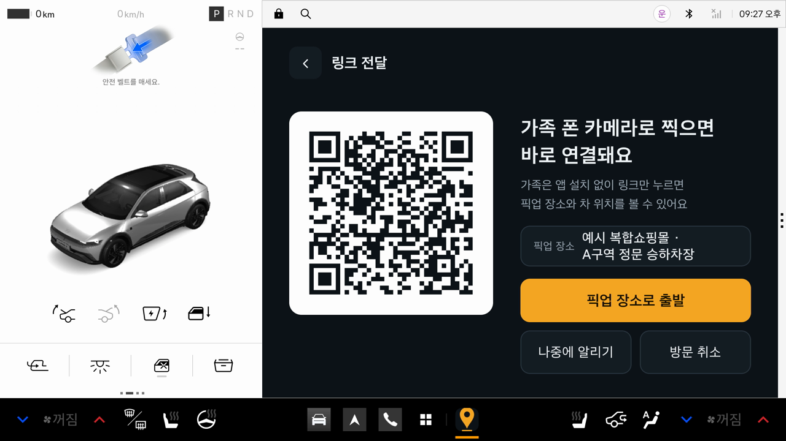
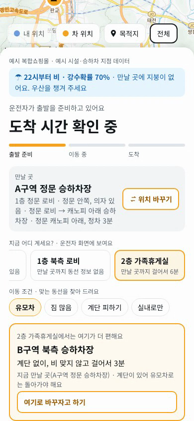
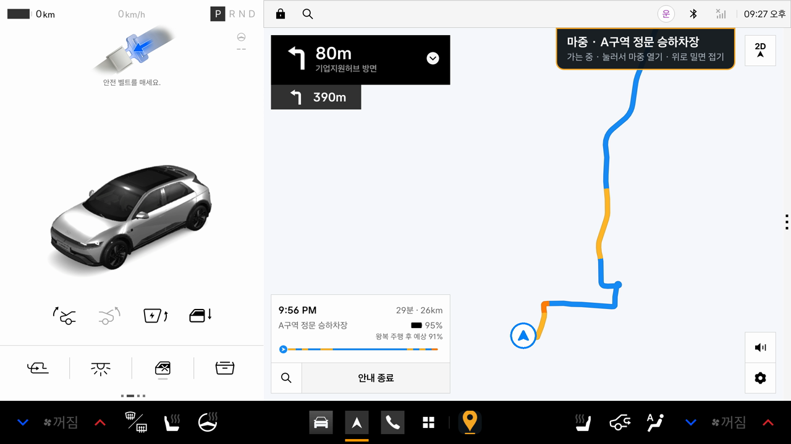
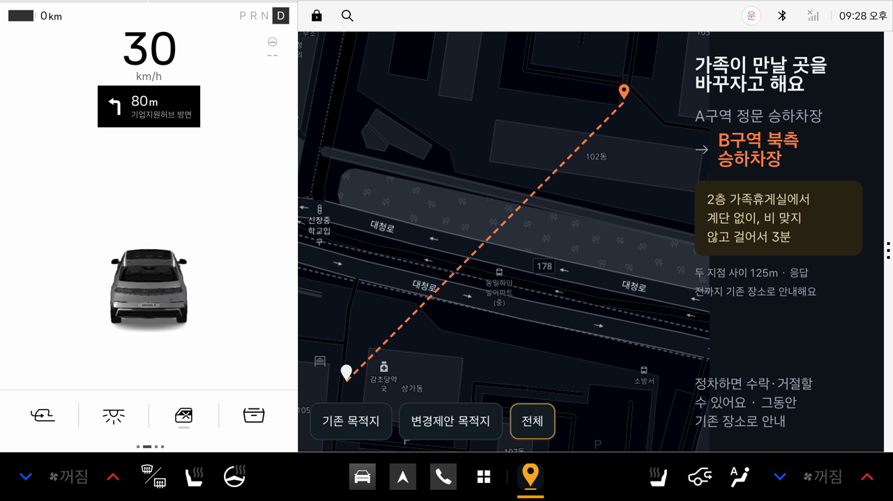
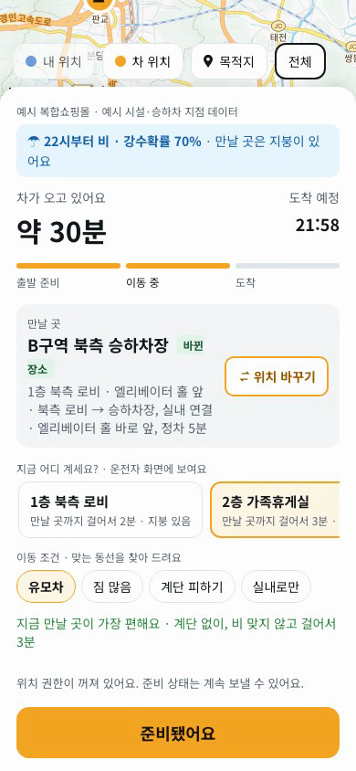
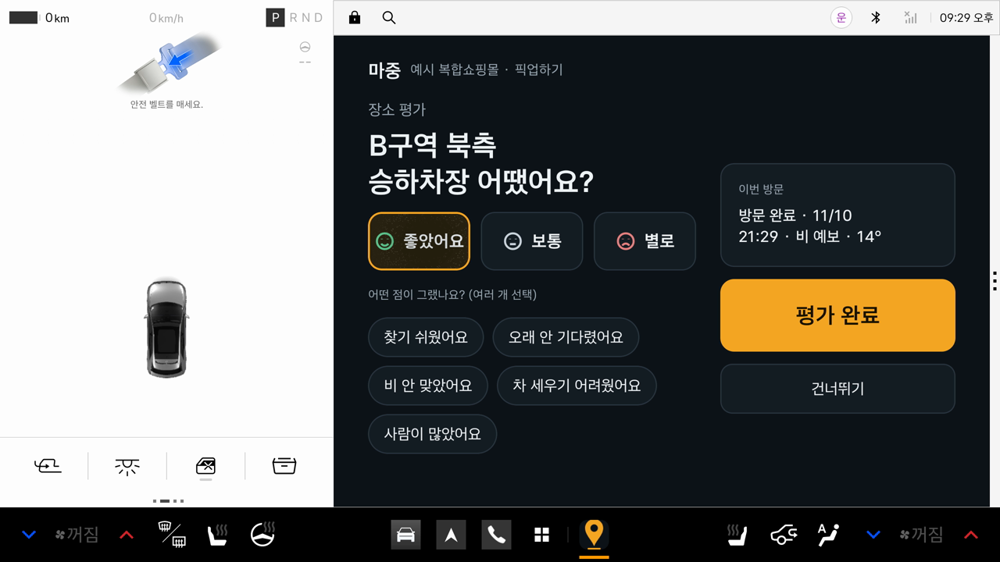
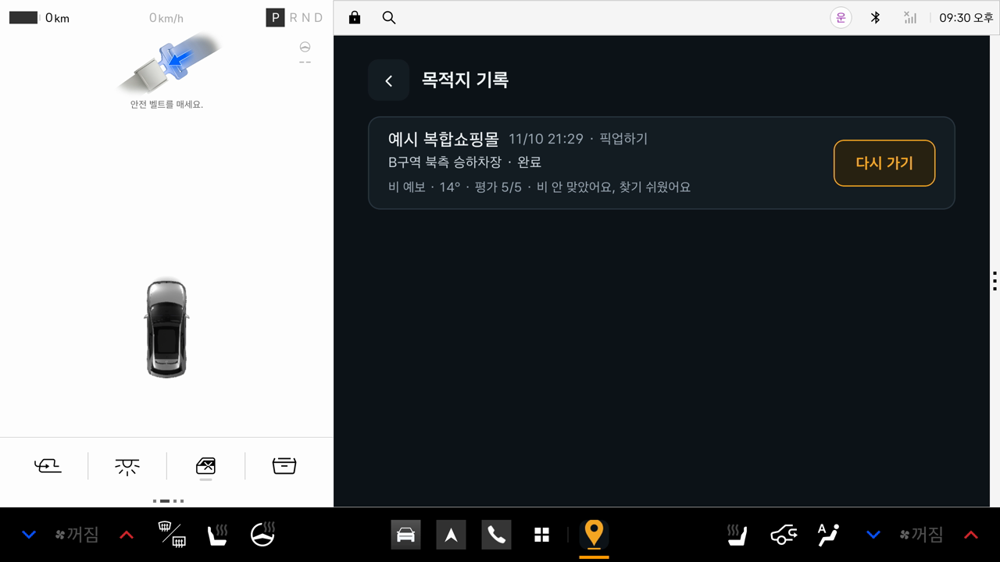

# 마중 (Majung)

**어디서 내리고, 어디서 기다리고, 언제 다시 만날지 — 차와 가족이 함께 정하는 Pleos Connect 차량 앱**

아이·유모차와 함께 복합쇼핑몰에 간 가족은 보통 운전자가 가족을 입구에 내려 주고 따로 움직였다가 다시 만납니다. 이때 "북문이라며?" "유모차로 서문은 계단이야" 같은 전화가 오가고 입구가 엇갈립니다.

마중은 차량이 설 수 있는 곳(승하차 구역·날씨)과 가족이 걸어 나올 길(대기 지점·유모차·계단)을 함께 보고 만날 곳을 정합니다. 정한 장소는 차량 내장 내비에 바로 들어갑니다. 가족은 앱 설치 없이 QR 링크 하나로 참여합니다.

> **시연 영상 (2분 38초):** [유튜브 ITDA 채널](https://www.youtube.com/@ITDA.HYUNDAI)  
> Pleos Connect 에뮬레이터와 가족 휴대폰 웹을 같은 서버에 붙여 실제로 조작한 화면입니다.

---

## 핵심 기능

| 화면 | 기능 |
|---|---|
|  | **날씨로 승하차 지점 추천**<br>목적지와 모드(픽업하기·내려주기·그냥가기)를 고르면 도착지의 기상청 단기예보를 봅니다. 6시간 안에 비·눈이 오면 지붕 있는 동선을 먼저 추천하고, 이유를 한 줄로 보여 줍니다. 지난번 평가도 순서에 반영합니다. |
|  | **QR 한 번으로 가족 연결**<br>방문을 시작하면 차량 화면에 QR이 뜹니다. 가족은 휴대폰 카메라로 찍기만 하면 앱 설치·가입 없이 같은 방문에 참여합니다. 링크는 24시간 뒤 만료됩니다. |
|  | **가족이 있는 곳과 조건으로 다시 추천**<br>가족은 "지금 어디 계세요?"에서 대기 지점(로비·가족휴게실)과 이동 조건(유모차·짐 많음·계단 피하기·실내로만)을 고릅니다. 마중은 그 자리에서 각 승하차 지점까지의 동선을 비교해, 계단이 있거나 유모차로 갈 수 없는 곳은 제외 이유와 함께 빼고 더 나은 곳을 추천합니다. "여기로 바꾸자고 하기"로 바로 제안합니다. |
|  | **차량 내장 내비 연동**<br>출발하면 확정된 승하차 지점이 Pleos 내장 내비의 목적지로 자동 입력되고, 안내 시작 이벤트로 결과를 확인합니다. 내비를 보는 동안에도 화면 위의 마중 배너와 알림 카드로 가족의 준비 상태와 제안을 놓치지 않습니다. |
|  | **주행 중 안전**<br>주행 중에는 화면을 꼭 필요한 것만 남기고, 가족의 장소 변경 제안은 "정차하면 수락·거절할 수 있어요 · 그동안 기존 장소로 안내"로 미룹니다. 정차 후 수락하면 내비 목적지가 새 장소로 바뀝니다. |
|  | **도착 예정 시간과 준비 상태 공유**<br>내비가 알려 주는 남은 시간을 받아 가족 화면에 "약 30분 · 21:58"로 보여 줍니다. 가족은 "준비됐어요 → 지금 나갈게요 → 로비에 도착했어요"를 눌러 운전석에 알립니다. |
|  | **탑승 확인과 장소 평가**<br>도착하면 가족이 모두 탔는지 확인하고, 이번 승하차 지점을 "좋았어요·보통·별로"와 이유 태그로 평가합니다. 평가는 다음 추천 순서에 반영됩니다. |
|  | **목적지 기록과 다시 가기**<br>기록에는 그날의 날씨와 평가가 남고, "다시 가기" 한 번으로 같은 장소의 방문을 바로 시작합니다. 앱이나 시동을 다시 켜도 서버에 저장된 진행 중인 방문으로 돌아옵니다. |

## Pleos Connect · SDK 활용

| 구분 | 사용한 것 | 마중에서 하는 일 | 코드 |
|---|---|---|---|
| Pleos NaviHelper | `requestRoute` | 확정한 승하차 지점을 내장 내비 목적지로 넣는다 | [PleosNaviClient.kt](apps/vehicle/app/src/main/java/com/majung/vehicle/pleos/navi/PleosNaviClient.kt) |
| | `onRouteStarted` / `onError` | 요청만으로 성공 처리하지 않고, 안내 시작 이벤트로 결과를 확정한다(20초 무응답이면 다시 시도 안내). 시작 시 전체 소요 시간을 받는다 | 〃 |
| | `getDestinationInfo` / `onDestinationInfo` | 안내 중 남은 시간·거리를 받아 가족 화면의 도착 예정 시간으로 공유한다(목적지가 마중 장소가 아니면 쓰지 않음) | 〃, [VehicleViewModel.kt](apps/vehicle/app/src/main/java/com/majung/vehicle/ui/VehicleViewModel.kt) |
| | `requestNavigationScreen` | "내비 보기"로 내비 화면을 앞으로 띄운다 | 〃 |
| | `onDestinationArrived` | 내비 도착 이벤트로 도착을 처리한다(도착지 이름이 같거나 300m 안일 때만) | 〃 |
| Android Car API | `CarUxRestrictionsManager` | 주행 상태에 따라 화면·조작을 제한한다(제안 응답·장소 변경·방문 취소는 정차 후) | [UxRestrictionWatcher.kt](apps/vehicle/app/src/main/java/com/majung/vehicle/core/uxrestriction/UxRestrictionWatcher.kt) |
| Android | 포그라운드 서비스 · 오버레이 · 알림 | 내비 위 마중 배너, 새 소식 카드, 백그라운드 위치·상태 동기화 | [core/notice](apps/vehicle/app/src/main/java/com/majung/vehicle/core/notice) |
| 권한 | `pleos.car.permission.NAVI_ROUTE`, `NAVI_ROUTE_SEARCH` | 경로 요청 | [AndroidManifest.xml](apps/vehicle/app/src/main/AndroidManifest.xml) |

큰 Pleos 화면(2560×1440)에서는 앱이 자동으로 커지고([PanelScale.kt](apps/vehicle/app/src/main/java/com/majung/vehicle/ui/theme/PanelScale.kt)), 모든 화면을 Pleos 에뮬레이터에서 확인했습니다.

## 구성

```
 차량 (Pleos Connect)                  가족 휴대폰 (브라우저)
 apps/vehicle                          apps/web
 Kotlin · Jetpack Compose              React · TypeScript · Vite · 카카오맵
 Pleos NaviHelper · Car API                      │
        │   HTTPS + WebSocket                    │  QR 링크 (앱 설치 없음)
        └──────────────┬─────────────────────────┘
                       ▼
                 apps/server
                 Fastify · node:sqlite · WebSocket
                 방문 상태 · 장소 합의 · 추천(날씨·동선·평가)
                 기상청 단기예보 · 카카오 로컬(주소)
```

| 폴더 | 내용 |
|---|---|
| [apps/vehicle](apps/vehicle) | 차량 앱 (Android Automotive / Pleos Connect) |
| [apps/web](apps/web) | 가족(동승자) 모바일 웹 |
| [apps/server](apps/server) | 방문 서버. DB 스키마는 [majung-db](apps/server/src/db/majung-db/UPSTREAM.md) |
| [packages/shared](packages/shared/src/index.ts) | 웹·서버 공용 API 타입 |
| [contracts/openapi.yaml](contracts/openapi.yaml) | API 계약 (OpenAPI) |
| [docs/api](docs/api/README.md) | API 문서 (요청·응답 예시, 에러 코드, curl 따라 하기) |

## 실행

요구 환경: Node 22.13 이상(검증 24.6.0), npm, JDK 17, Android SDK 35.

### 1. 서버와 가족 웹

```bash
npm ci
cp apps/server/.env.example apps/server/.env   # 키는 선택 사항
cp apps/web/.env.example apps/web/.env
npm run dev:server     # http://localhost:4000/health
npm run dev:web        # http://localhost:5173 (별도 터미널)
```

웹 개발 서버는 `/api`와 `/ws`를 4000으로 전달하므로 두 서버를 함께 켭니다. DB는 `apps/server/data/majung.sqlite`에 저장되고, 비어 있으면 예시 시설을 넣습니다.

| 환경 변수 | 위치 | 없으면 |
|---|---|---|
| `KMA_SERVICE_KEY` | `apps/server/.env` | 날씨 없이 걷는 시간 순으로 추천 ([공공데이터포털 기상청 단기예보](https://www.data.go.kr)) |
| `WEATHER_DEMO=rain\|clear` | `apps/server/.env` | 키 없이 시연할 때 고정 날씨. 키가 있으면 무시 |
| `KAKAO_REST_KEY` | `apps/server/.env` | 지도에서 고른 위치가 주소 대신 "지도에서 고른 위치"로 표시 |
| `VITE_KAKAO_MAP_KEY` | `apps/web/.env` | 가족 화면 지도가 뜨지 않음 (다른 기능은 동작) |

### 2. 차량 앱 (Pleos 에뮬레이터)

1. Android Studio → SDK Manager → SDK Update Sites에 Pleos 시스템 이미지를 추가하고 **Pleos Connect v2.1.0** 이미지를 설치합니다(약 19GB).
   - Apple Silicon: `https://nexus-playground.pleos.ai/repository/raw-releases/connect-avd/2.x/crp-arm64-sys-img.xml`
   - Intel: `https://nexus-playground.pleos.ai/repository/raw-releases/connect-avd/2.x/crp-sys-img.xml`
2. 이 이미지로 AVD를 만들고(Cold boot), `-gpu host`로 실행합니다. 처음 켠 뒤에는 내장 내비 앱을 한 번 열어 두어야 첫 경로 요청이 성공합니다.
3. 앱을 빌드해 운전자 사용자(user 10)에 설치합니다.

```bash
cd apps/vehicle
./gradlew assembleDebug
adb -s emulator-5554 install -r --user 10 app/build/outputs/apk/debug/app-debug.apk
adb -s emulator-5554 shell pm grant --user 10 com.majung.vehicle android.permission.POST_NOTIFICATIONS
adb -s emulator-5554 shell appops set --user 10 com.majung.vehicle SYSTEM_ALERT_WINDOW allow   # 내비 위 배너
```

에뮬레이터는 서버를 `http://10.0.2.2:4000`으로 찾습니다. 실제 휴대폰으로 QR을 찍으려면 PC의 LAN IP로 빌드합니다(`-PwebUrl=http://<LAN IP>:5173 -PserverUrl=http://<LAN IP>:4000`). 휴대폰에서 내 위치까지 공유하려면 HTTPS 웹(`npm run dev:web:https`, 5174)을 씁니다.

## 테스트

```bash
npm run typecheck
npm run build
npm test -w @majung/server      # 26개: 방문 흐름, 권한·버전 충돌·중복 요청, 실시간 방송, 날씨·추천, 대기 지점·이동 조건, 평가 반영
npm test -w @majung/web         # 7개
cd apps/vehicle && ./gradlew testDebugUnitTest assembleDebug
```

## 데이터와 보안

- 방문마다 운전자·동승자 토큰을 따로 발급해 역할별 권한을 검사합니다. 링크는 24시간 뒤 만료되고, 토큰이 든 URL은 서버 로그에 남기지 않습니다.
- 모든 쓰기는 트랜잭션, 버전 검사(`version`), 요청 번호(`requestId`) 재시도 처리를 거칩니다. 동시 변경은 409로 거절하고, 앱은 최신 상태를 다시 받아 옵니다(백그라운드 위치 전송은 한 번 더 보냄).
- 위치는 진행 중인 최신 값과 갱신 시각만 보관하고 전체 이동 궤적은 저장하지 않습니다.

## 현재 범위와 한계

- **시설 데이터는 예시입니다.** 시설명·좌표·승하차 지점·동선은 검증용 예시이며 앱에도 표시합니다. 실제 운영에는 현장 확인한 데이터로 바꿔야 합니다.
- **문자·카카오톡 공유는 연결하지 않았습니다.** 공유는 QR입니다. 연락처 문자 보내기 화면과 서버 엔드포인트는 있지만, 발송 업체가 연결되지 않아 기본 빌드에서는 숨겨져 있습니다(`-PsmsInvite=true`).
- **에뮬레이터 내비는 지도 바탕을 그리지 않습니다.** Pleos 에뮬레이터의 내장 내비 렌더링 문제로, 경로선·턴바이턴·도착 예정 시간은 정상입니다.
- **내비 도착 자동 감지는 에뮬레이터에서 확인하지 못했습니다.** 에뮬레이터 내비가 경로를 따라 움직이지 않기 때문이며, "도착했어요" 버튼으로 진행합니다.
- 현재 실행 구성은 로컬·신뢰 네트워크 개발용입니다. 공개 배포에는 HTTPS 서버와 영속 DB 볼륨이 필요합니다.

---

팀 ITDA · 현대자동차그룹 차량용 앱 개발 공모전 2026
