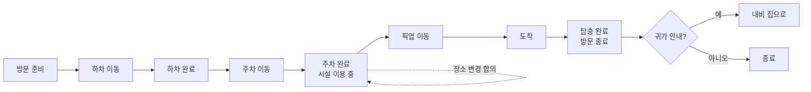
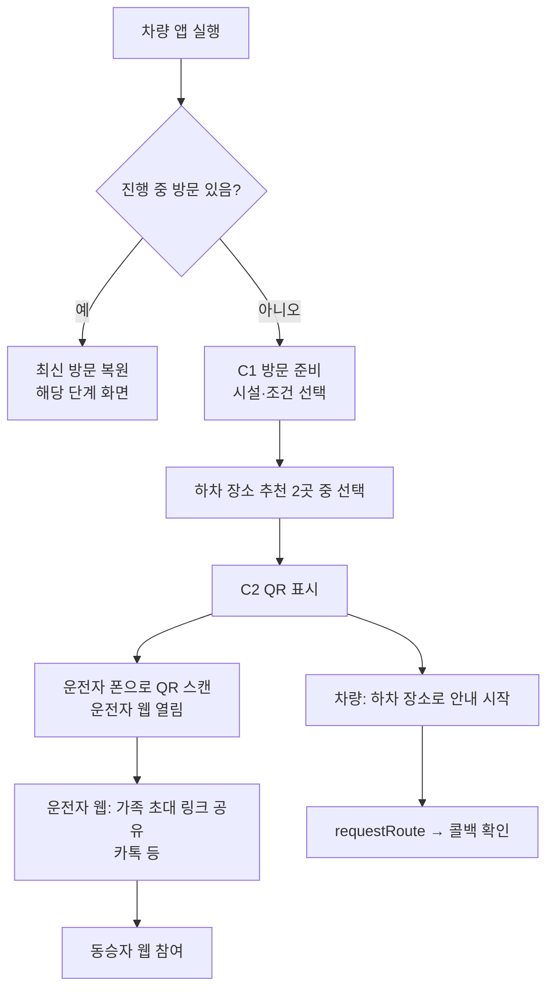
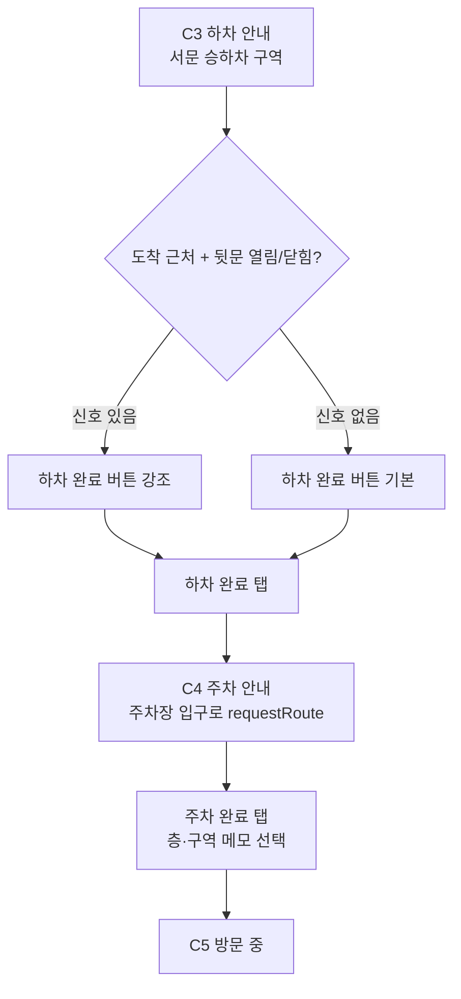
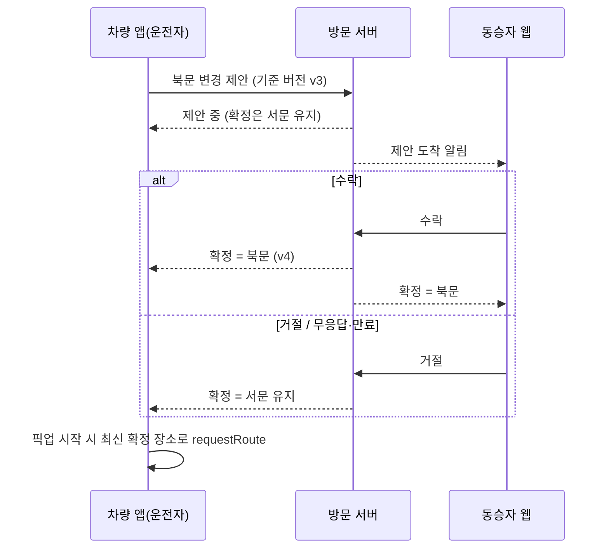
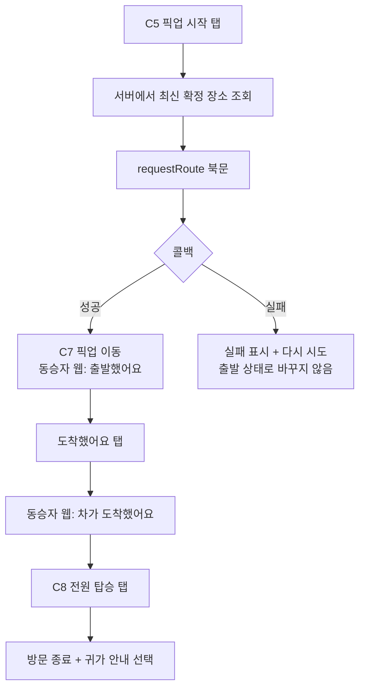

# 마중 UI 설계 (차량 앱 + 모바일 웹)

작성일: 2026-10-26 | 기준: 마중 서비스기획서 v0.1 (10/23) P0 + 10/24 회의 시나리오 B
범위: P0 = 함께 출발 → 하차 → 주차 → 장소 합의 → 픽업 → 탑승. 회의의 A·C(데리러 가기)는 7~9단계만 쓰는 "픽업만 모드"로 P1.

---

## 0. 설계 원칙

| 원칙 | 적용 |
|---|---|
| 한 화면 = 버튼 하나 | 차량 화면은 단계마다 큰 주요 버튼 1개 + 보조 1개까지 |
| 주행 중엔 보기만 | 입력·선택·QR·비교는 정차 중(UX 제한 꺼짐)에만. 주행 중엔 같은 화면이 "읽기 전용"으로 바뀜 |
| 내비가 주인공 | 우리 앱은 내비 옆 카드. 목적지를 넘기면 화면은 상태만 보여줌 |
| 확정은 사람이 | 하차·주차·도착·탑승은 버튼으로 확정. 문·좌석 신호는 "버튼을 띄우는 계기"로만 |
| 상태는 정직하게 | 합의 완료 ≠ 내비 반영 완료. "요청 중 / 안내 중 / 실패"를 따로 표시. 연결 끊기면 마지막 갱신 시각 |
| 두 화면 같은 이름 | 차량·운전자 웹·동승자 웹이 같은 장소명("북문 로비"), 같은 단계명을 씀 |

차량 화면 해상도·가로세로 비율은 `[확인 필요: Pleos 에뮬레이터 해상도]`. 일단 가로형 기준, 다크 테마 기본.

---

## 1. 전체 상태 흐름 (방문 단계)



단계(phase)와 별도로 굴러가는 상태 3개 — 화면은 이 조합을 다 표현해야 함:
'

| 상태 | 값 |
|---|---|
| 장소 제안 | 없음 / 제안 중 / 수락 / 거절 / 만료 |
| 내비 반영 | 미반영 / 요청 중 / 안내 중 / 실패 |
| 차량 연결 | 연결됨 / 끊김(마지막 갱신 시각) |

---

## 2. 사용자 플로우

### 2-1. 시작과 연결 (정차 중)



QR 단계는 건너뛰기 가능 (나중에 C5에서 다시 열 수 있음). 동승자 연결 없이도 하차·주차 안내는 동작해야 함.

### 2-2. 하차와 주차 (주행 포함)



### 2-3. 장소 변경 합의 (핵심 시연)



제안은 운전자 웹에서도 가능(차 꺼진 동안). 픽업 시작 이후엔 제안 버튼 비활성.

### 2-4. 픽업과 종료



---

## 3. 화면 목록

### 차량 앱 (C)

| ID | 화면 | 정차 중 | 주행 중 | 주요 버튼 | 쓰는 API |
|---|---|---|---|---|---|
| C0 | 홈 | 방문 시작 | "정차 후 시작하세요" | 방문 시작 | — |
| C1-0 | 이번 방문은? | "가족과 같이 가요 / 가족 데리러 가요" (뒷좌석 탑승 감지로 기본 선택) | 진입 불가 | 선택 | `getCurrentSeatOccupancy` |
| C1 | 방문 준비 | 시설·조건 칩·후보 2곳 선택 | 진입 불가 | 이 장소로 출발 | `getCurrentLocationInfo` |
| C2 | 가족 연결 QR | QR 크게 | QR 숨김 | 건너뛰기 | — |
| C3 | 하차 안내 | 목적지·대기 장소 설명 | 장소명 + 내비 상태만 | 하차 완료 | `requestRoute`, 콜백, `getCurrentDoorPosition`, `getCurrentSeatOccupancy` |
| C4 | 주차 안내 | 층·구역 메모 입력 | 장소명만 | 주차 완료 | `requestRoute` |
| C5 | 방문 중 | 약속 장소·동승자 상태·제안 | (주차 상태라 주로 정차) | 픽업 시작 / 장소 변경 | 서버 조회 |
| C6 | 장소 변경 제안 | 후보 비교 + 추천 이유 | 진입 불가 | 제안 보내기 | (P1 날씨) |
| C7 | 픽업 이동 | 동승자 준비 상태 | 장소명 + 동승자 준비 여부 | 도착했어요 | `requestRoute`, (P1 `getRouteStateInfo`) |
| C8 | 도착·탑승 | 탑승 확인 | — | 전원 탑승 | `getCurrentSeatBeltBuckledState`(보조) |
| C9 | 종료 | 요약 + 귀가 안내 | — | 집으로 / 닫기 | `requestRoute` |

공통 배너: 연결 끊김(마지막 갱신 시각) / 처리 확인 중 / 내비 실패.

### 모바일 웹 (M) — 한 페이지, 역할로 갈림

| ID | 화면 | 운전자 | 동승자 |
|---|---|---|---|
| W1 | 링크 진입 | "이 차의 운전자로 이어받기" | "가족 방문에 참여하기" |
| W2 | 방문 카드(홈) | 단계 타임라인, 약속 장소, 주차 메모, 가족 초대 공유 | 약속 장소 + 대기 위치 사진·설명, 차 진행 상태, 준비됐어요 |
| W3 | 장소 변경 | 제안 보내기 (픽업 전) | 수락 / 거절 시트 |
| W4 | 픽업 진행 | 상태만 | 출발했어요 → 도착했어요 (+ ETA 있으면) |
| W5 | 종료 | 요약 | 요약 |
| WE | 오류 | 링크 만료 / 종료된 방문 / 오래된 화면(새로고침) | 동일 |

---

## 4. 와이어프레임 (핵심 화면)

### C3 하차 안내 — 정차 중 / 주행 중

```
┌──────────────────────────────────────────────┐
│ 마중 · 스타필드 ○○                 ● 연결됨     │
├──────────────────────────────────────────────┤
│  1 하차  ─  2 주차  ─  3 시설 이용  ─  4 픽업    │
│                                              │
│   서문 승하차 구역으로 안내 중                    │
│   ▸ 내비 안내 중 ✓                             │
│                                              │
│   가족 대기: 서문 로비 (엘리베이터 앞)             │
│   유모차 OK · 지붕 있음                         │
│                                              │
│        ┌──────────────────────────┐          │
│        │        하차 완료            │          │
│        └──────────────────────────┘          │
└──────────────────────────────────────────────┘
주행 중: 아래 설명 숨김, "서문 승하차 구역 · 안내 중"만. 버튼은 정차 시 활성.
```

### C5 방문 중 (주차 후)

```
┌──────────────────────────────────────────────┐
│ 약속 장소                                      │
│   서문 로비            확정 v3 · 10:42          │
│ 가족                                           │
│   ● 연결됨 · 아직 준비 중                        │
│                                              │
│ ☂ 15시 비 예보 → 북문은 지붕이 승하차 구역까지      │
│   [ 북문으로 바꾸자고 하기 ]                     │
│                                              │
│        ┌──────────────────────────┐          │
│        │        픽업 시작            │          │
│        └──────────────────────────┘          │
└──────────────────────────────────────────────┘
제안 중일 때: "북문 제안 중 · 수락 전까지 서문 유지" 배지.
```

### W2 동승자 방문 카드

```
┌────────────────────────┐
│ 마중                    │
│ 만날 곳                 │
│ ┌────────────────────┐ │
│ │ [사진]  서문 로비     │ │
│ │ 엘리베이터 앞 벤치     │ │
│ └────────────────────┘ │
│ 차 상태                 │
│ ✓ 하차 ✓ 주차 ○ 픽업 출발 │
│                        │
│ [   준비됐어요   ]       │
└────────────────────────┘
```

### W3 동승자 변경 수락 (바텀시트)

```
┌────────────────────────┐
│ 운전자가 만날 곳을        │
│ 바꾸자고 해요             │
│ 서문 로비 → 북문 로비     │
│ 이유: 15시 비 예보,       │
│ 북문은 지붕이 이어져요     │
│ [사진] 북문 로비          │
│ [ 좋아요 ]  [ 서문 유지 ] │
│ 응답 없으면 서문 유지       │
└────────────────────────┘
```

---

## 5. 문구표 (상태별, 세 화면 공통)

| 상태 | 차량 | 동승자 웹 |
|---|---|---|
| 내비 요청 중 | 안내 준비 중… | — |
| 내비 실패 | 내비에 넣지 못했어요 · 다시 시도 | — |
| 하차 완료 | 주차장으로 안내할게요 | 내리셨어요. 서문 로비에서 만나요 |
| 주차 완료 | 주차했어요 · B2 C구역 | 운전자가 주차했어요 |
| 제안 중 | 북문 제안 중 · 수락 전까지 서문 | 만날 곳을 바꾸자고 해요 |
| 수락 | 북문으로 확정됐어요 | 북문 로비에서 만나요 |
| 거절/만료 | 서문 그대로예요 | 서문 그대로예요 |
| 픽업 출발 | 북문으로 안내 중 | 차가 출발했어요 (약 6분) ← ETA 있을 때만 |
| 도착 | 가족 탑승을 확인해주세요 | 차가 도착했어요 · 북문 승하차 구역 |
| 연결 끊김 | 서버 연결 끊김 · 10:42 기준 | 차 연결 끊김 · 10:42 기준 |

---

## 6. 화면 → 서버 API (API 폴더 구조용)

| 화면 동작 | 서버 API |
|---|---|
| C1 방문 시작 | `POST /visits` |
| C2 QR / W1 진입 | `POST /visits/:id/links`, `POST /links/:token/claim` |
| C3·C4·C7·C8 단계 확정 | `POST /visits/:id/events` (요청 ID 포함) |
| 내비 결과 보고 | `PUT /visits/:id/navigation` |
| C6·W3 제안 | `POST /visits/:id/proposals` |
| W3 응답 | `POST /proposals/:id/accept`, `/reject` |
| W2 준비됐어요 | `POST /visits/:id/events` (passenger_ready) |
| 모든 화면 | `GET /visits/:id` + 실시간 구독(웹소켓 또는 3초 조회) |
| 시설·후보 | `GET /facilities/:id` |

```
server/src/
  routes/   visits.ts links.ts proposals.ts facilities.ts
  services/ visitService.ts proposalService.ts
  db/       schema.sql  (Facility, AccessPoint, Visit, Participant, MeetingProposal, NavigationStatus, VisitEvent)
  realtime/ subscribe.ts
```

---

## 7. 할 일 순서 (UI 담당)

1. 화면 목록·플로우 팀 합의 (이 문서) — 특히 A·C를 P1로 미루는 것
2. 시연 흐름 화면부터 와이어: C5 → C6 → W3 → C7 → W4 (기획서 14장 장면)
3. 나머지: C1·C2·C3·C4·C8·W1·W2·WE
4. 주행 중 버전, 오류·끊김 상태 화면
5. 컴포넌트 정리: 단계 표시줄, 장소 카드, 상태 배지, 주요 버튼, 배너
6. Figma 고화질 → 개발 전달

## 8. 확인 필요

- Pleos 에뮬레이터 화면 해상도·비율, 내비와 분할 화면인지 전체 화면인지
- 주행 중 우리 앱 화면이 보이는지, 신호 대기에도 제한되는지 (`CarUxRestrictionsManager`)
- 내비 안내 중 우리 앱으로 전환하면 내비가 뒤로 가는지 (화면 구성에 영향)
- 실제 시설 이름·사진 (시설 담당에게 받기)
